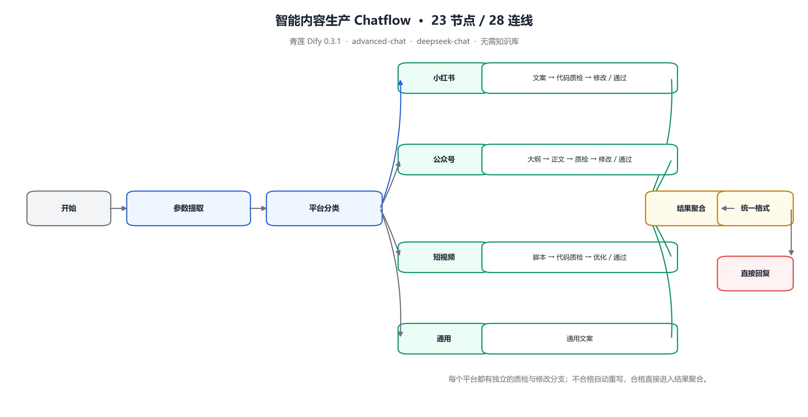

# Dify DSL Creator

> 用 Claude Code 生成、修复和校验可导入的青莲 Dify / Dify 工作流与 Chatflow DSL。

<p>
  
  
  
  
</p>

Dify 的 DSL 是 YAML，但真正难的不是 YAML 语法，而是节点字段、变量选择器、分支 handle、连线方向、上游引用和画布布局。只要有一个地方不一致，导入后就可能出现“节点存在但变量为空”“分支永远不走”“画布全叠在一起”等问题。

这个 Skill 把这些约束整理成 Claude Code 可以执行的流程：先确认业务和拓扑，再从真实底座生成节点与连线，最后用校验器逐项检查，直到输出 `VALIDATION_OK`。

---

## ✨ 能做什么

- 生成 `workflow` 工作流：`start → ... → end`
- 生成 `advanced-chat` Chatflow：`start → ... → answer`
- 支持 LLM、知识检索、问题分类、条件分支、代码、模板转换、HTTP 请求、变量聚合、参数提取、文档提取、变量赋值等常用节点
- 修复已有的 Dify DSL：补节点、补连线、改变量引用、调整布局
- 在导入前做结构校验，提前发现会导致导入失败或运行异常的问题
- 针对青莲 Dify `0.3.1` 做了真实导出校准
- 自带一个 **23 节点 / 28 连线** 的完整内容生产 Chatflow 案例，不依赖知识库和外部 API

## 🧩 支持的应用模式

| 模式 | 结构 | 适用场景 |
| --- | --- | --- |
| `workflow` | `start → ... → end` | 批处理、自动化、定时任务、API 调用 |
| `advanced-chat` | `start → ... → answer` | 对话助手、多轮问答、Chatflow |
| `agent-chat` | Agent 节点 | 仅在目标实例有真实导出可参考时使用 |
| `chat` / `completion` | 简单应用 | 基础模板可用，复杂编排建议用上面两种 |

> `iteration`、`loop`、`agent`、`tool` 和插件节点不要凭空生成。必须先从目标 Dify 实例导出真实节点和 `dependencies`，再按真实结构复制。

---

## 🚀 快速开始

### 1. 克隆到 Claude Code 的 skills 目录

**Windows PowerShell：**

```powershell
git clone https://github.com/<your-github-username>/dify-dsl-creator.git "$env:USERPROFILE\.claude\skills\dify-dsl-creator"
```

**macOS / Linux：**

```bash
git clone https://github.com/<your-github-username>/dify-dsl-creator.git ~/.claude/skills/dify-dsl-creator
```

如果目录已经存在，先备份或换一个目录名。

### 2. 安装校验器依赖

```bash
cd ~/.claude/skills/dify-dsl-creator
python -m pip install -r requirements.txt
```

只需要 Python 3.9+ 和 PyYAML。

### 3. 在 Claude Code 里直接描述需求

```text
用 dify-dsl-creator 帮我做一个青莲 Dify 0.3.1 的 advanced-chat 应用。

业务：市场团队多平台文案生成
输入：主题、平台、受众、语气、字数
流程：参数提取 → 平台分类 → 小红书/公众号/短视频/通用 → 代码质检 → 不合格自动修改 → 聚合输出
输出：可直接发布的文案
模型：deepseek-chat
限制：不用知识库、不接外部 API

请先给我节点清单和拓扑，确认后再生成 YAML。
生成后保存到本地，并运行校验到 VALIDATION_OK。
```

### 4. 校验生成结果

```bash
python scripts/validate_dify_dsl.py path/to/app.yml
```

通过时输出：

```text
VALIDATION_OK
```

有阻塞问题时输出 `ERROR: ...`，退出码非 0。

严格模式（警告也视为失败）：

```bash
python scripts/validate_dify_dsl.py --strict path/to/app.yml
```

查看节点、连线、变量引用摘要：

```bash
python scripts/inspect_dify_dsl.py path/to/app.yml
```

---

## 💬 常用 Prompt

**从零生成 Chatflow：**

```text
用 dify-dsl-creator 做一个 advanced-chat 应用：
用户输入问题后，先做问题分类，再走售后/售前/其他三个分支，最后统一回复。
模型用 deepseek-chat，不用知识库。先给拓扑，再生成 YAML 并校验。
```

**生成 RAG 工作流：**

```text
用 dify-dsl-creator 做一个 workflow：
start 接收 query → 知识检索 → LLM 回答 → end。
知识库节点先用占位 dataset_id，生成后提示我替换。
```

**修复已有 DSL：**

```text
这是我导出的 Dify DSL：path/to/app.yml。
导入时报 variable not found，请定位所有无效变量引用，
修正后重新校验，并告诉我改了哪些节点。
```

**只调整布局：**

```text
这个 DSL 的结构没问题，但画布节点重叠。
请保持节点和连线不变，只按分支层级重新排列 x/y 坐标。
```

---

## 🔍 校验器检查什么

`scripts/validate_dify_dsl.py` 是结构校验器，不连接 Dify，也不执行工作流。它会检查：

- 根节点 `kind`、`version`、`app.mode` 是否合法
- `workflow` 是否有且只有一个 `end`
- `advanced-chat` 是否有 `answer`
- 节点 ID 是否重复，节点类型是否受支持
- 节点必填字段是否齐全
- 问题分类 / 条件分支的 handle 是否与 class ID、`case_id` 对应
- 边的 `source` / `target` 是否存在
- 变量选择器和模板引用是否指向真实的上游输出
- 节点输出键是否在白名单内
- 图是否连通，是否存在孤立节点
- 画布坐标是否重叠
- 是否混入 FastGPT 语法
- 文件是否为 UTF-8

它**不会**检查：

- 目标 Dify 是否安装了对应模型或插件
- 知识库、数据集、API Key 是否真实可用
- Prompt 的生成质量
- 工作流运行时的业务正确性

所以 `VALIDATION_OK` 表示“结构可以导入”，不表示“运行一定成功”。导入后仍要用真实输入测试一次。

---

## 🏭 完整案例：智能内容生产 Chatflow

`examples/qinglian-content-factory-chatflow.yml` 是一个可直接参考的完整案例：

- 青莲 Dify `0.3.1`
- `advanced-chat`
- `deepseek-chat`
- 23 个节点，28 条连线
- 不需要知识库
- 不需要外部 API
- 小红书、公众号、短视频、通用四条内容生产线
- 每条生产线都有代码质检和“不合格自动修改”分支
- 分支结果聚合后统一格式输出



核心拓扑：

```text
start
  → extract_params
  → classify_platform
      ├─ 小红书：writer → check → if → revise → merge
      ├─ 公众号：outline → draft → check → if → revise → merge
      ├─ 短视频：script → check → if → revise → merge
      └─ 通用：general_llm
  → final_merge
  → format_output
  → final_answer
```

直接查看：

- [Chatflow YAML](examples/qinglian-content-factory-chatflow.yml)
- [Word 版使用指南](docs/quickstart.docx)

---

## 🧱 项目结构

```text
dify-dsl-creator/
├── SKILL.md                     # Skill 主入口：生成流程、约束、检查清单
├── README.md                    # GitHub 说明
├── requirements.txt             # PyYAML
├── LICENSE                      # MIT
├── agents/
│   └── openai.yaml              # Agent 配置
├── assets/
│   ├── base-workflow.yml                # 标准 Dify 工作流底座
│   ├── base-chatflow.yml                # 标准 Dify Chatflow 底座
│   ├── base-qinglian-chatflow.yml       # 青莲 Chatflow 底座
│   ├── base-qinglian-workflow.yml       # 青莲 Workflow 底座
│   └── qinglian-blank-workflow.yml      # 青莲原始空白 workflow 导出
├── examples/
│   ├── chatflow-rag.yml
│   ├── qinglian-chatflow-rag.yml
│   ├── qinglian-content-factory-chatflow.yml
│   ├── workflow-classifier.yml
│   └── workflow-http.yml
├── references/
│   ├── dsl-structure.md
│   ├── node-contracts.md
│   ├── node-templates.md
│   ├── variable-reference-rules.md
│   ├── workflow-patterns.md
│   ├── validation-checklist.md
│   ├── version-compatibility.md
│   ├── qinglian-dify-profile.md
│   └── troubleshooting.md
├── scripts/
│   ├── validate_dify_dsl.py
│   └── inspect_dify_dsl.py
└── docs/
    ├── quickstart.docx
    └── images/
        └── content-factory-flow.png
```

---

## 🪷 青莲 Dify 适配

已用真实的青莲 Dify `version: 0.3.1` 导出校准：

- Chatflow 从 `assets/base-qinglian-chatflow.yml` 起稿
- Workflow 从 `assets/base-qinglian-workflow.yml` 起稿
- 支持青莲的 `[startNodeId, 'sys.query']` 系统变量选择器
- 支持 `llm.memory`、`retry_config`、`ssl_verify`、`isInLoop` 等青莲导出中出现的字段
- 支持 `type: marketplace` 和 `marketplace_plugin_unique_identifier`
- 默认模型以目标实例实际安装为准，不硬编码某个供应商

两个容易踩的坑：

1. **“空白流程”不一定是 workflow。** 先检查 `app.mode`；`advanced-chat` 仍然是 Chatflow。
2. **青莲空白 workflow 导出没有 `end`。** 直接校验会报缺少结束节点，这是预期行为；生成时必须补 `end` 和连线。

更多细节见 [qinglian-dify-profile.md](references/qinglian-dify-profile.md)。

---

## 📚 参考文档

| 文档 | 内容 |
| --- | --- |
| [dsl-structure.md](references/dsl-structure.md) | DSL 根结构、节点、边、依赖 |
| [node-contracts.md](references/node-contracts.md) | 各节点必填字段和输出 |
| [node-templates.md](references/node-templates.md) | 可直接复制的节点模板 |
| [variable-reference-rules.md](references/variable-reference-rules.md) | 选择器与模板引用规则 |
| [workflow-patterns.md](references/workflow-patterns.md) | 分类、RAG、HTTP 兜底、质检回环等模式 |
| [validation-checklist.md](references/validation-checklist.md) | 导入前检查清单 |
| [version-compatibility.md](references/version-compatibility.md) | 版本差异和适配建议 |
| [qinglian-dify-profile.md](references/qinglian-dify-profile.md) | 青莲 Dify 实测结构 |
| [troubleshooting.md](references/troubleshooting.md) | 常见导入和运行问题 |

---

## ⚠️ 版本与限制

- 默认以目标 Dify 导出的空白应用为准，这是最稳妥的版本适配方式。
- 标准 Dify 模板使用 `0.3.0`，青莲模板使用 `0.3.1`。
- 如果导入提示版本不支持，参考 [version-compatibility.md](references/version-compatibility.md)。
- 不要把其他平台的 DSL 语法直接混进来；校验器会拦截 FastGPT 风格的写法。
- Agent 模式、插件节点、工具节点的结构差异较大，必须有真实导出再生成。
- 本项目是 Claude Code Skill，不是 Dify 插件，也不替代 Dify 运行时。

## 🤝 贡献

欢迎提交 Issue 或 PR，尤其是：

- 新的真实 Dify / 青莲 Dify 空白导出
- 新的节点结构样本
- 导入失败案例和修复方法
- 更完整的校验规则

提交前请先运行至少一个示例：

```bash
python scripts/validate_dify_dsl.py examples/qinglian-content-factory-chatflow.yml
```

## 📄 License

[MIT](LICENSE)

---

如果这个 Skill 帮你省下了手写 YAML 的时间，欢迎点一个 ⭐ Star。
